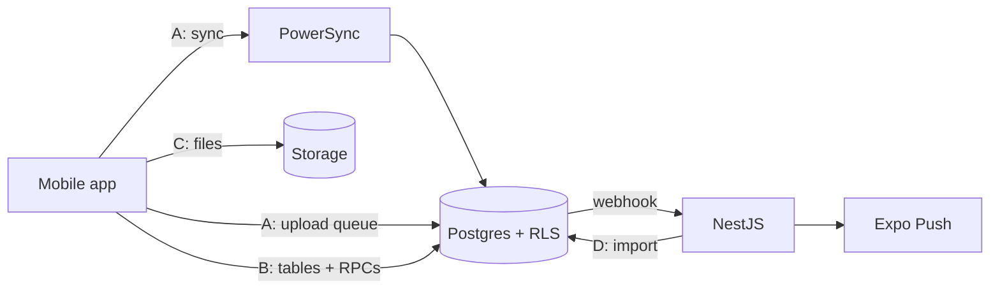

# Lymbr — API

**Version**: 1.0
**Created**: 2026-11-02
**Status**: Draft for review
**Related**: `data-model.md` (tables, RLS, RPC list), `architecture.md` §4–5 (components and flows), `rules.md` §3–4 (security and validation rules)

This document defines every way the mobile app talks to the backend: what it calls, with which inputs, what comes back, and which errors are possible.

---

## 1. Overview: four API surfaces

Lymbr has no single "REST API" for everything. Each kind of data uses the surface that fits it best.

| # | Surface | Used for | Works offline? |
|---|---|---|---|
| A | **Sync (PowerSync + upload connector)** | All user-owned data: sessions, sets, plans, gyms, body metrics, nutrition, recovery, PRs, photos metadata | **Yes** (queued) |
| B | **Supabase direct (PostgREST + RPCs)** | Social: friends, feed, likes, comments, plan sharing, gym buddies, notifications inbox | No |
| C | **Supabase Storage** | Photo and avatar files | Uploads queue offline |
| D | **NestJS API** | wger import, push notifications (via webhooks), account deletion cleanup, health | Not called by app for daily use |



---

## 2. Authentication

- The app signs in with **Supabase Auth** (email + password, Google, Apple).
- Every request to Supabase, PowerSync and NestJS carries the user's **Supabase access token** (JWT) as `Authorization: Bearer <token>`.
- **PowerSync** validates the same JWT through its Supabase Auth integration (`client_auth.supabase: true`, or "Use Supabase Auth" in the dashboard), which trusts Supabase's JWT signing keys.
- **NestJS** validates the JWT with a guard and reads `sub` as the user ID. Service endpoints (webhooks, admin) use a separate shared secret instead.
- Tokens refresh automatically via the Supabase client. If the refresh token has expired while offline, logging continues locally and the user is asked to sign in again when back online. Local data is kept.

### 2.1 Sign-up flow

1. `supabase.auth.signUp()` (or OAuth).
2. A database trigger on `auth.users` creates a `profiles` row with a generated temporary username.
3. Onboarding calls `update_profile` (§4.1) to set username, units, goal, week start, and timezone, then optionally writes the first `body_metrics` row through sync.

---

## 3. Surface A: Sync

### 3.1 Reading

The app never fetches its own data over HTTP. PowerSync syncs the `library` and `user_data` Sync Streams (`data-model.md` §8) into local SQLite, and screens query SQLite directly with reactive queries.

### 3.2 Writing

1. The app writes to local SQLite inside a transaction (e.g., insert a `sets` row).
2. PowerSync queues the change as a CRUD operation: `PUT` (insert/replace), `PATCH` (update), or `DELETE`.
3. The **upload connector** (`apps/mobile/db/connector.ts`) sends each queued operation to Supabase with the user's JWT:

| Queued op | Supabase call |
|---|---|
| PUT | `from(table).upsert(row)` |
| PATCH | `from(table).update(changes).eq('id', id)` |
| DELETE | Converted to `update({ deleted_at: now })`. Hard deletes are never sent. |

4. RLS checks every write (owner only). Triggers correct `updated_at` and `weight_kg`.

### 3.3 Upload error handling

| Error | Meaning | Connector behaviour |
|---|---|---|
| Network / 5xx / timeout | Temporary | Keep in queue; retry with backoff. |
| 401 | Token expired | Refresh token, retry. If refresh fails, pause uploads and prompt sign-in. |
| 403 / RLS violation (`42501`) | Not allowed | Should never happen in normal use. Log, move op to a local `failed_uploads` table, continue the queue. Show "Some changes couldn't sync" with details. |
| Constraint violation (`23xxx`), check failure | Invalid data | Same as 403: never block the whole queue on one bad row. |

**Rule:** a single failed row must never stop other rows from syncing, and must never be silently discarded (`rules.md` §1.5).

### 3.4 Validation

Every row written locally is validated first with the Zod schema for that table from `packages/shared/schemas`. Postgres constraints and triggers are the second line of defence.

---

## 4. Surface B: Supabase RPCs

All RPCs are Postgres functions called with `supabase.rpc(name, params)`. Each one:

- runs as the caller (or `security definer` with an explicit `auth.uid()` check where it touches other users' rows),
- validates inputs and raises errors with the codes in §8,
- is atomic (one transaction).

Inputs and outputs are also defined as Zod schemas in `packages/shared/api` so the app's types match.

### 4.1 Profile

#### `update_profile`
Called by onboarding and settings. (Profile edits could also go through sync; this RPC exists because changing a username needs a uniqueness check while online.)

| Param | Type | Notes |
|---|---|---|
| p_username | text? | 3–20 chars, `[a-z0-9_]`, case-insensitive unique. |
| p_display_name | text? | |
| p_default_unit | `kg` \| `lb`? | |
| p_display_unit | `kg` \| `lb`? | |
| p_week_start | smallint? | 0–6 |
| p_timezone | text? | Valid IANA name. |
| p_weekly_goal | smallint? | 1–14 or null. |
| p_streak_visibility | `private` \| `friends`? | |

Returns: the updated profile. Errors: `USERNAME_TAKEN`, `INVALID_USERNAME`, `INVALID_INPUT`.

Only provided params change. Offline edits to non-username fields go through sync instead.

#### `search_users`

| Param | Type | Notes |
|---|---|---|
| p_query | text | Min 2 chars; prefix match on username and display name. |
| p_limit | int | Default 20, max 50. |

Returns: `[{ id, username, display_name, avatar_path, friendship_status }]`. Excludes the caller and anyone who blocked them or whom they blocked.

### 4.2 Friends

| RPC | Params | Returns | Behaviour | Errors |
|---|---|---|---|---|
| `send_friend_request` | p_username | friendship | Creates `pending` row. If the other user already requested the caller, accepts it instead. | `USER_NOT_FOUND`, `ALREADY_FRIENDS`, `REQUEST_EXISTS`, `BLOCKED`, `CANNOT_FRIEND_SELF` |
| `respond_friend_request` | p_friendship_id, p_accept boolean | friendship | Only the addressee may respond. Accept → `accepted`; decline → `declined`. | `NOT_FOUND`, `NOT_ALLOWED` |
| `remove_friend` | p_user_id | void | Deletes the friendship row. Access to shared content ends immediately (RLS). | `NOT_FOUND` |
| `block_user` | p_user_id | void | Sets/creates row with `blocked`, `blocked_by = caller`. Removes pending buddy tags and plan shares between them. | `CANNOT_BLOCK_SELF` |
| `unblock_user` | p_user_id | void | Only the blocker can unblock; removes the row (they're no longer friends). | `NOT_FOUND`, `NOT_ALLOWED` |

**Invite links**: `lymbr://add/<username>` (and an https universal link) open the app's profile screen, which calls `send_friend_request`.

#### Listing friends (direct query)

```ts
supabase.from('friendships')
  .select('id, status, requester_id, addressee_id, requester:public_profiles!requester_id(*), addressee:public_profiles!addressee_id(*)')
  .or(`requester_id.eq.${me},addressee_id.eq.${me}`)
  .in('status', ['accepted', 'pending'])
```

### 4.3 Feed

#### `get_feed`

| Param | Type | Notes |
|---|---|---|
| p_before | timestamptz? | Cursor: return items older than this. Null = newest. |
| p_limit | int | Default 20, max 50. |

Returns an array of feed items, newest first:

```jsonc
[
  {
    "type": "session",
    "id": "uuid",                       // session id
    "occurred_at": "2026-11-02T09:15:00Z",
    "author": { "id": "uuid", "username": "whi", "display_name": "Whi", "avatar_path": "…" },
    "session": {
      "plan_name": "Push Day",
      "local_date": "2026-11-02",
      "duration_minutes": 68,
      "gym_name": "Gym A",              // null if hide_gym
      "exercise_count": 6,
      "set_count": 21,
      "pr_count": 2,
      "muscle_groups": ["chest", "front_delts", "triceps"],
      "cover_photo_path": "…",          // only if that photo is visible to the caller
      "buddies": [{ "id": "uuid", "username": "ana" }]
    },
    "like_count": 3,
    "liked_by_me": true,
    "comment_count": 1
  },
  {
    "type": "streak_milestone",
    "id": "uuid",
    "occurred_at": "2026-11-02T00:00:00Z",
    "author": { "…": "…" },
    "milestone": { "weeks": 12 }
  }
]
```

Includes only sessions where `can_view_session` is true and status is `finished`, plus streak milestones from friends whose `streak_visibility = friends`. No ranking, no sorting by likes. Chronological only (`rules.md` §1.4).

#### `get_session_detail`

| Param | Type |
|---|---|
| p_session_id | uuid |

Returns the full shared session for a friend: entries (exercise and variation names, origin, status, swapped-from), sets (all set columns except internal ones), PRs, visible photos, notes, gym (unless hidden), buddies, like/comment counts. The owner reads their own sessions from local SQLite, not from this RPC.

Errors: `NOT_FOUND` (also returned when not allowed, so existence isn't leaked).

### 4.4 Likes and comments (direct table access, RLS-checked)

| Action | Call |
|---|---|
| Like | `from('likes').insert({ id, session_id, user_id: me })` (duplicate → `23505`, treat as success) |
| Unlike | `from('likes').delete().eq('session_id', id).eq('user_id', me)` |
| List comments | `from('comments').select('*, author:public_profiles!user_id(*)').eq('session_id', id).is('deleted_at', null).order('created_at')` |
| Add comment | `from('comments').insert({ id, session_id, user_id: me, body })`, body 1–1000 chars |
| Edit comment | `update({ body, edited_at: now })`, own only |
| Delete comment | `update({ deleted_at: now })`, own or as session owner |

Inserts trigger notifications (§6).

### 4.5 Plan sharing

| RPC / call | Params | Behaviour | Errors |
|---|---|---|---|
| Share with all friends | Sync: set `plans.visibility = 'friends'` | Works offline; visible once synced. | – |
| `share_plan` | p_plan_id, p_recipient_ids uuid[] | Creates `plan_shares` rows. Recipients must be friends. Sends `plan_shared` notification. | `NOT_FOUND`, `NOT_FRIENDS` |
| `unshare_plan` | p_plan_id, p_recipient_id | Deletes the share row. | `NOT_FOUND` |
| `get_shared_plans` | p_friend_id? | Lists plans the caller can view (all friends, or one friend), with entry count and muscles. | – |
| `get_plan_detail` | p_plan_id | Plan, entries, alternatives, exercise/variation names, for a friend's plan. | `NOT_FOUND` |
| `copy_plan` | p_plan_id | See below. | `NOT_FOUND` |

#### `copy_plan`
In one transaction:

1. Check `can_view_plan(p_plan_id)`.
2. Create a new `plans` row owned by the caller: same name, notes, entries; `visibility = private`; no schedule; `copied_from_plan_id`, `copied_from_user_id` set.
3. Copy `plan_entries` and `plan_entry_alternatives` with new IDs.
4. For every **custom** exercise/variation referenced, create a copy owned by the caller (with its muscles and equipment) and point the copied entries at it. Library items are referenced as-is.
5. Return `{ plan_id }`.

The new rows reach the caller's phone through sync.

### 4.6 Gym buddies

| RPC | Params | Behaviour | Errors |
|---|---|---|---|
| `tag_buddies` | p_session_id, p_user_ids uuid[] | Caller owns the session; each user must be a friend. Creates `buddy_tags` (pending) and `buddy_invite` notifications. | `NOT_FOUND`, `NOT_FRIENDS` |
| `respond_buddy_tag` | p_buddy_tag_id, p_accept | Tagged user only. On accept: creates a session for them (same `local_date`, `started_at`, plan name snapshot, their own private visibility) with copies of the tagger's entries (`origin = planned`, `status = pending`), no sets. Custom variations are copied as in `copy_plan`. Sets `created_session_id`, notifies the tagger. Returns `{ session_id }`. | `NOT_FOUND`, `NOT_ALLOWED`, `ALREADY_RESPONDED` |
| `untag_buddy` | p_buddy_tag_id | Session owner removes a tag. Doesn't delete a session the buddy already created. | `NOT_FOUND` |

Tagging can be done offline in the UI. The app stores pending tags locally and calls `tag_buddies` when back online.

### 4.7 Notifications inbox

| Action | Call |
|---|---|
| List | `from('notifications').select('*, actor:public_profiles!actor_id(*)').eq('recipient_id', me).order('created_at', { ascending: false }).limit(50)` |
| Mark read | `update({ read_at: now })` by id, or RPC `mark_all_notifications_read()` |
| Unread count | `select('id', { count: 'exact', head: true }).is('read_at', null)` |
| Realtime | Subscribe to `notifications` inserts for `recipient_id = me` while the app is open |

### 4.8 Push tokens

| Action | Call |
|---|---|
| Register | `from('push_tokens').upsert({ owner_id: me, token, platform, last_seen_at }, { onConflict: 'token' })` on app start, after permission is granted. Not synced; one row per token, `id` generated by the server. |
| Remove | Delete on sign-out |

### 4.9 Account

| RPC | Behaviour |
|---|---|
| `delete_account` | Requires recent sign-in (token `iat` < 10 minutes). Marks the profile for deletion and fires a webhook to NestJS (§5.3). The app signs out and clears local data. |

Data export (US16) needs no API: the app builds CSV/JSON from local SQLite.

---

## 5. Surface C: Storage

### 5.1 Session photos

| Step | Detail |
|---|---|
| Pick & compress | `expo-image-picker` → `expo-image-manipulator`: longest side 1600 px, JPEG quality 0.8, EXIF location removed. |
| Record | Insert `photos` row via sync (works offline). |
| Queue | Add file to the PowerSync attachment queue (local-only state: pending, uploading, uploaded, failed). |
| Upload | `storage.from('session-photos').upload('{owner_id}/{session_id}/{photo_id}.jpg', file, { upsert: true })` |
| View (own) | Local file if present; otherwise a signed URL. |
| View (friend) | `storage.from('session-photos').createSignedUrl(path, 3600)`. Storage policy checks the `photos` row visibility. |
| Delete | Soft-delete row via sync; NestJS cleanup removes the file after the purge window. |

Limits: 5 live photos per session (trigger), max upload 10 MB.

### 5.2 Avatars

Path `avatars/{owner_id}.jpg`, 512 px square. Owner writes; any signed-in user can get a signed URL.

---

## 6. Surface D: NestJS API

Base URL: `https://api.lymbr.app/v1` (placeholder). JSON only.

### 6.1 Endpoints

| Method | Path | Auth | Purpose |
|---|---|---|---|
| GET | `/health` | none | Liveness check. |
| POST | `/webhooks/notifications` | Webhook secret | Called by a Supabase database webhook on `notifications` insert. Sends push. |
| POST | `/webhooks/account-deletion` | Webhook secret | Deletes the user's storage objects, then rows, then the auth user. |
| POST | `/admin/wger-import` | Admin secret | Manually trigger a library import. |
| GET | `/admin/wger-import/:runId` | Admin secret | Import status and counts. |

Scheduled jobs (not HTTP):

| Job | Schedule | Purpose |
|---|---|---|
| wger import | Weekly | Refresh library (§6.3). |
| Purge soft-deleted rows | Nightly | Hard-delete rows (and photo files) deleted more than 30 days ago. |
| Prune push tokens | Weekly | Remove tokens not seen in 90 days or rejected by Expo. |

### 6.2 `POST /webhooks/notifications`

Request (from Supabase webhook):

```json
{
  "type": "INSERT",
  "table": "notifications",
  "record": {
    "id": "uuid",
    "recipient_id": "uuid",
    "actor_id": "uuid",
    "type": "comment",
    "session_id": "uuid",
    "comment_id": "uuid"
  }
}
```

Behaviour:

1. Verify the webhook secret header.
2. Load the recipient's `notification_settings`; stop if this type is turned off.
3. Build the message, e.g. "Ana commented on your Push Day". No weights, photos or comment text in the push itself (privacy on lock screens).
4. Send to all recipient's tokens via Expo Push in one batch.
5. Set `notifications.pushed_at`. Remove tokens Expo reports as invalid.

Response: `204`. Idempotent: if `pushed_at` is already set, do nothing.

**Plan reminders** don't use this endpoint. They are scheduled as local notifications on the phone (`expo-notifications`) from `plans.schedule_days` and `reminder_time`, so they work offline.

### 6.3 wger import

1. Fetch muscles, equipment, categories, and exercises (English) from the wger public API, paginated.
2. Map wger muscles → `muscle_groups` via `wger_muscle_map`.
3. Group exercises by wger variation group → `exercises`; each wger exercise → `variations` (`data-model.md` §4.2).
4. Upsert by `wger_*` IDs. Never delete; mark missing items `is_active = false`.
5. Store image URLs (and licence/author fields for attribution).
6. Record a run summary: created, updated, deactivated, errors.

The import uses the Supabase secret key and is the only writer of library rows.

### 6.4 NestJS conventions

- Modules: `auth`, `webhooks`, `notifications`, `wger-import`, `cleanup`, `health`.
- Validation with Zod schemas from `packages/shared`.
- Errors use the format in §7.
- Secrets from environment variables only.

---

## 7. Error format

### 7.1 RPC errors

RPCs raise Postgres exceptions with a stable code in the message hint:

```sql
RAISE EXCEPTION 'Username is taken' USING ERRCODE = 'P0001', HINT = 'USERNAME_TAKEN';
```

The app maps `hint` to a friendly message. Unknown errors show a generic "Something went wrong. Try again."

### 7.2 NestJS errors

```json
{ "error": { "code": "INVALID_SIGNATURE", "message": "Webhook signature is invalid." } }
```

### 7.3 Error codes

| Code | Meaning |
|---|---|
| `INVALID_INPUT` | Validation failed (details in message). |
| `INVALID_USERNAME` | Username format not allowed. |
| `USERNAME_TAKEN` | Username already used. |
| `USER_NOT_FOUND` | No user with that username. |
| `NOT_FOUND` | Item doesn't exist **or** caller can't see it. |
| `NOT_ALLOWED` | Caller can see it but can't do this action. |
| `NOT_FRIENDS` | Action requires an accepted friendship. |
| `ALREADY_FRIENDS` | Already friends. |
| `REQUEST_EXISTS` | A pending request already exists. |
| `CANNOT_FRIEND_SELF` / `CANNOT_BLOCK_SELF` | Self-targeted action. |
| `BLOCKED` | One user has blocked the other. |
| `ALREADY_RESPONDED` | Invite already accepted or declined. |
| `REAUTH_REQUIRED` | Sensitive action needs a recent sign-in. |
| `RATE_LIMITED` | Too many requests. |

---

## 8. Limits

| Item | Limit |
|---|---|
| Friend requests | 50 per day per user |
| Comments | 60 per hour per user; 1000 chars each |
| Likes | 300 per hour per user |
| User search | 30 per minute per user |
| Feed page size | Max 50 |
| Photos | 5 per session, 10 MB per upload |
| Buddy tags | 10 per session |

Enforced in RPCs (counts over a time window) and Supabase settings. Exceeding returns `RATE_LIMITED`.

---

## 9. Versioning and compatibility

- **RPCs**: never change an existing function's inputs or outputs in a breaking way. Add a new one (`get_feed_v2`) and remove the old one only after all app versions in use have moved over.
- **NestJS**: path prefix `/v1`.
- **Sync schema**: new columns must be nullable or have defaults, so older app versions keep syncing. Removing a column takes two releases (stop using it, then drop it).
- **Minimum app version**: the `app_config` table holds `min_supported_version`. The app checks it on start and asks the user to update if below.

---

## 10. Testing the API (summary; detail in `testing.md`)

- Every RPC: happy path plus each error code.
- RLS: friend, non-friend, pending, blocked, and owner cases for every social read.
- Upload connector: offline queue, token expiry, a rejected row not blocking others.
- Webhooks: invalid secret rejected; duplicate delivery doesn't double-push.
- wger import: idempotent re-run; removed exercise becomes inactive, history intact.
