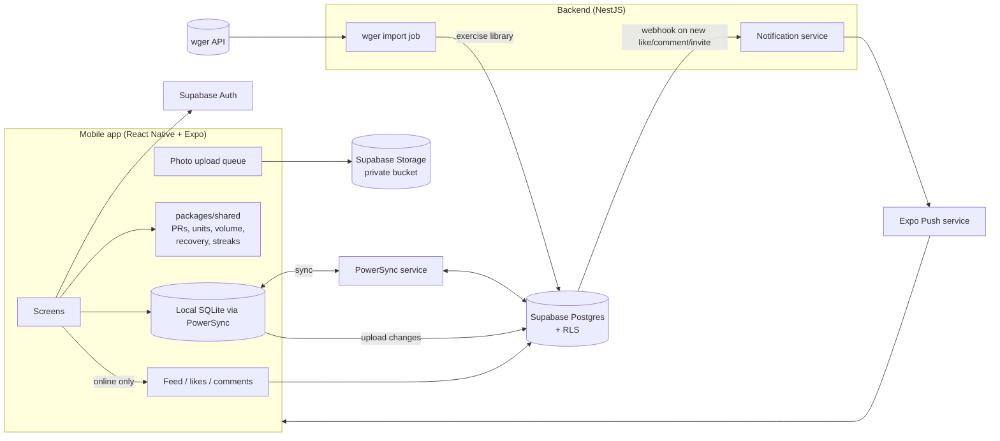

# Lymbr — Architecture

**Version**: 1.0
**Created**: 2026-11-02
**Status**: Draft for review
**Related**: `specs.md` (requirements), `rules.md` (rules that constrain this design)

This document explains how Lymbr is built: the stack, the parts of the system, how data flows, and the key technical decisions. The detailed schema lives in `data-model.md` and the endpoints in `api.md`. This file defines the shape they must fit.

---

## 1. Architecture at a glance

Lymbr is an **offline-first mobile app**. The phone has its own database and is the main place work happens. The cloud is used to sync, back up, share with friends, and run background jobs.



**In short:**

- The app reads and writes its **local database**, so logging is instant and works offline.
- **PowerSync** keeps the local database and Supabase Postgres in sync in the background.
- **Supabase** provides Postgres, authentication, photo storage and row-level security.
- **NestJS** runs the jobs that shouldn't run on a phone: importing the wger library and sending push notifications.
- The **social feed** is online-only and reads directly from Supabase.

---

## 2. Tech stack

| Layer | Choice | Why |
|---|---|---|
| Mobile framework | React Native + Expo (with dev builds), TypeScript | One codebase for iOS and Android; Expo handles builds, updates and push. |
| Navigation | Expo Router | File-based routing, deep links for friend invites. |
| Local database + sync | **PowerSync** (SQLite on device) | Built for offline-first sync with Postgres; official Supabase integration and React Native & Expo SDK. See decision D1. |
| Server state (online-only data) | TanStack Query | Caching and retries for feed, comments, friend search. |
| UI state | Zustand | Small, simple store for the active session screen and UI preferences. |
| Forms & validation | React Hook Form + Zod | Zod schemas shared with the backend. |
| Charts | Victory Native (or similar Skia-based charts) | Fast charts for progression. Final pick during design. |
| Body heatmap | `react-native-svg` with our own front/back body SVG | Full control over muscle regions and colours. |
| Images | `expo-image-picker`, `expo-image-manipulator`, `expo-image` | Pick, compress, cache. |
| Backend database | Supabase Postgres | Relational data fits this domain; RLS enforces privacy. |
| Auth | Supabase Auth (email, Google, Apple) | Built in; JWTs work for both Supabase and NestJS. |
| File storage | Supabase Storage (private bucket) | Photos with signed URLs. |
| Backend service | NestJS (TypeScript) | Structured modules for the import job and notifications; shares code with the app. |
| Push notifications | Expo Push service | Works with Expo apps on both platforms. |
| Exercise library | wger (imported, not called live) | Free, no auth for public data, includes muscles and equipment. |
| Monorepo | pnpm workspaces + Turborepo | Share `packages/shared` between app and API. |
| Testing | Jest, React Native Testing Library, Maestro (E2E), pgTAP for RLS | See `testing.md`. |
| CI | GitHub Actions | Typecheck, lint, test on every PR. |

---

## 3. Repository structure

```
lymbr/
├─ apps/
│  ├─ mobile/              # Expo app
│  │  ├─ app/              # Expo Router screens
│  │  ├─ features/         # one folder per feature (logging, plans, calendar, social…)
│  │  ├─ db/               # PowerSync schema, connector, queries
│  │  ├─ components/       # shared UI components
│  │  ├─ theme/            # design tokens and typography
│  │  ├─ lib/              # Supabase client, error reporting
│  │  ├─ assets/body-map/  # front/back body SVGs
│  │  ├─ e2e/              # Maestro flows
│  │  └─ eas.json          # EAS Build profiles
│  └─ api/                 # NestJS service
│     └─ src/
│        ├─ health/
│        ├─ auth/          # Supabase JWT guard
│        ├─ webhooks/
│        ├─ notifications/
│        ├─ wger-import/
│        ├─ account/
│        └─ cleanup/
├─ packages/
│  └─ shared/              # pure TS: units, PRs, volume, recovery, streaks, Zod schemas, types
├─ supabase/
│  ├─ config.toml          # Supabase CLI and local stack
│  ├─ migrations/          # all schema + RLS changes
│  ├─ seed.sql             # muscles, equipment, test data
│  └─ tests/               # pgTAP tests: RLS, RPCs, triggers
├─ powersync/
│  ├─ sync-config.yaml     # Sync Streams: what data each user syncs
│  └─ docker-compose.yaml  # local PowerSync service (+ service.yaml config)
├─ eslint-rules/           # custom lint rules (radius, icons)
├─ .github/workflows/      # CI
├─ package.json, pnpm-workspace.yaml, turbo.json, tsconfig.base.json
├─ README.md
└─ specs.md, rules.md, architecture.md, data-model.md, api.md,
   flows.md, design.md, testing.md, tasks.md
```

---

## 4. Components and responsibilities

### 4.1 Mobile app

Owns everything the user does, offline included:

- **Logging** (US1): creates Session, SessionEntry and Set rows locally. Swaps, skips and additions only touch session rows, never plan rows. On finish, if the session deviated from its plan, it asks before writing to the plan.
- **"Last time" and PRs** (US5): local queries over the user's own sets, computed with `packages/shared`. PR detection runs on device as each working set is saved, so it works offline.
- **Calendar, progression, heatmap, recovery, streaks** (US6, 7, 9, 10): all computed from local data.
- **Gym profiles and swap suggestions** (US8): local data plus the cached exercise library.
- **Export** (US16): built from the local database into CSV and JSON, then shared with the system share sheet. No server needed.
- **Photo uploads**: compressed on device, queued, uploaded when online.
- **Social screens** (US11, 12, 14): online-only, use Supabase directly through TanStack Query.

### 4.2 PowerSync (sync layer)

- Streams the user's own data and the shared exercise library from Postgres into local SQLite.
- Queues local changes and uploads them through our connector to Supabase.
- Sync Streams decide what each user downloads (section 6).

### 4.3 Supabase

- **Postgres**: the source of truth once data has synced.
- **RLS policies**: enforce private-by-default and friends-only sharing (see `rules.md` §3).
- **Postgres functions (RPCs)** for multi-step social actions that must be atomic: accepting a friend request, copying a friend's plan, accepting a gym-buddy invite.
- **Storage**: private `session-photos` and `avatars` buckets.
- **Auth**: sign-up, sign-in, JWTs.
- **Database webhooks**: notify NestJS when likes, comments, friend requests or buddy invites are created.

### 4.4 NestJS API

Kept small on purpose. Its jobs:

- **wger import**: scheduled job that fetches exercises, muscles, equipment and images from wger and upserts them into our library tables. Never deletes; marks removed items as inactive.
- **Notifications**: receives webhooks, checks the recipient's notification settings, sends via Expo Push, and stores tokens per device.
- **Future server logic** that doesn't belong in SQL or on the phone.

User-facing endpoints verify the Supabase JWT. `GET /health` is public, and webhook and admin endpoints use shared secrets instead (`api.md` §2 and §6.1). The service uses the Supabase secret key, which never leaves the server.

---

## 5. Key data flows

Detailed sequence diagrams are in `flows.md`. The essentials:

### 5.1 Logging a session (offline-safe)

1. User starts a session from a plan. The app copies the plan's entries into new SessionEntry rows in local SQLite (a snapshot).
2. Each set is written locally as soon as it's entered. PR detection runs locally.
3. Swaps, skips and reorders update only SessionEntry rows.
4. On finish: if any entry differs from the plan, ask "Save these changes to the plan?" (default No).
5. PowerSync uploads the rows whenever there's a connection.

### 5.2 Sync and conflicts

- Each Set, SessionEntry and Session is its own row, so two devices editing different sets never conflict.
- Same-row conflicts use **last write wins** by the server's `updated_at`, which in practice means the last upload wins (a known v1 limitation, see §10).
- Deletes are soft (`deleted_at`), so a delete and an edit on different devices never lose a set silently. The deleted row stays recoverable.

### 5.3 Sharing a session

1. User sets the session's visibility to Friends (and optionally individual photos).
2. The change syncs to Postgres.
3. Friends' feed queries read it directly from Supabase; RLS allows it because the row is shared and they are accepted friends.

### 5.4 Copying a friend's plan

Calls an RPC that, in one transaction, creates a new Plan and PlanEntries owned by the copier, copies any custom variations as the copier's own, and records "copied from". The new rows then sync down to the copier's phone.

### 5.5 Notifications

Like/comment/request inserted → database webhook → NestJS → Expo Push → friend's phone.

---

## 6. Data and sync design

### 6.1 Main tables (detail in `data-model.md`)

| Group | Tables |
|---|---|
| Library (global, read-only for users) | `exercises`, `variations` (where `source = 'wger'`), `muscles`, `muscle_groups`, `equipment` |
| User-owned, synced | `profiles`, `body_metrics`, `gyms`, `gym_equipment`, custom `exercises`/`variations`, `plans`, `plan_entries`, `sessions`, `session_entries`, `sets`, `personal_records`, `photos`, `recovery_inputs`, `nutrition_logs` |
| Social, online | `friendships`, `likes`, `comments`, `plan_shares`, `buddy_tags`, `notifications`, `push_tokens` |

### 6.2 Sync Streams (what each phone downloads)

PowerSync Sync Streams (`powersync/sync-config.yaml`) define what syncs. Sync Streams replaced PowerSync's older Sync Rules, which are deprecated.

- **`library` stream**: the whole active exercise library, muscles, equipment.
- **`user_data` stream**: every row the user owns in the user-owned tables.
- **Not synced**: social tables and friends' data. These are fetched online.

The library is small enough (well under a few thousand exercises) to sync in full.

### 6.3 Weights and units

Each `sets` row stores `weight_value`, `weight_unit` (`kg` | `lb` | `stack`) and a computed `weight_kg`. All comparisons (PRs, volume, charts) use `weight_kg`; display uses the original value or the user's display unit. `stack` weights are only compared within the same variation. See `rules.md` §2.

### 6.4 Muscles and the body map

- wger muscles are mapped to our 18 `muscle_groups` (chest, upper back, lats, traps, front delts, side delts, rear delts, biceps, triceps, forearms, abs, obliques, lower back, glutes, quads, hamstrings, adductors, calves). `data-model.md` §4.2 is the source of truth for this list.
- Each muscle group has a region ID in the front/back body SVG.
- Weekly volume: primary muscle = 1 set, secondary = 0.5 set, warm-ups excluded.

### 6.5 Recovery estimate

Pure function in `packages/shared`:

- Base: ~48 h after training a muscle; ~72 h if that muscle got high volume (6 or more working sets in the session, primary = 1, secondary = 0.5) or any set to failure.
- Soreness (0–3): +24 h per level above 1.
- Readiness (1–5): 1 → +24 h, 2 → +12 h, 3 → 0, 4 → −6 h, 5 → −12 h.
- The total recovery window never goes below 24 h; only a manual override can make it shorter.
- A manual "recovered / not recovered" override always wins.
- The function returns both the estimate and the reasons, so the UI can explain it.

---

## 7. Security and privacy

- RLS on every table, default deny (see `rules.md` §3).
- Shared content requires: row visibility = friends, accepted friendship, no block in either direction.
- Body metrics, nutrition and recovery inputs have owner-only policies with no sharing path.
- Photos: private bucket; signed URLs created only after a per-photo visibility check.
- Mobile app holds only the Supabase publishable key; the secret key lives only in NestJS.
- Account deletion: an RPC plus a NestJS job removes rows and storage objects.

---

## 8. Environments and deployment

| Environment | Purpose | Notes |
|---|---|---|
| Local | Development | Supabase CLI local stack; PowerSync self-hosted locally via Docker or a dev instance. |
| Dev | Shared testing | Separate Supabase project and PowerSync instance. |
| Prod | Whi and friends | Separate Supabase project and PowerSync instance. |

- **Mobile**: Expo EAS Build for installable builds; EAS Update for quick JS-only fixes. Android first: distribute to friends via Google Play internal testing. TestFlight (iOS) is deferred until there is an Apple Developer account.
- **API**: deployed as a container to a small host (choice deferred; any Node host works).
- **Migrations**: applied by CI to dev, then manually promoted to prod.

---

## 9. Key decisions

| # | Decision | Alternatives considered | Reason |
|---|---|---|---|
| D1 | **PowerSync** for offline sync | WatermelonDB + custom RPC sync; RxDB; custom SQLite queue | Purpose-built for Postgres/Supabase with a React Native & Expo SDK and attachment support. WatermelonDB means maintaining two schemas plus custom sync functions, and has reported compatibility issues with React Native's New Architecture. |
| D2 | **Import wger into our database** | Call the wger API live | Works offline, faster search, history survives upstream changes. |
| D3 | **Keep NestJS small** | Put all logic in NestJS; use only Supabase Edge Functions | Most logic must run on device for offline use; RLS + RPCs cover social writes; NestJS handles jobs that need a server. |
| D4 | **Shared pure logic package** | Duplicate logic in app and server | One tested source of truth for PRs, units, volume, recovery and streaks. |
| D5 | **Social is online-only** | Sync friends' data to the phone | Simpler, smaller local database, and privacy changes take effect immediately. |
| D6 | **Last write wins, per row** | CRDTs | Data is mostly single-user; per-set rows make real conflicts rare. |

---

## 10. Risks and open items

- **PowerSync hosting cost/limits**: start on the hosted free tier or self-host the open edition; review when the test group grows.
- **wger data quality**: some exercises lack images or muscles. Users can edit muscles on their own variations; we may curate a starter set.
- **Body map art**: need a front/back SVG with separable muscle regions (to make or license during design).
- **Known limitation (v1): "last write wins" means last upload wins.** The server sets `updated_at` when a change arrives, which avoids phone clock drift. The cost: if an older offline edit uploads after a newer edit of the same row from another device, the older edit wins. Accepted for v1, because data is mostly single-user and every set is its own row, so it takes the same set edited on two devices.
- **Push notification permissions** on iOS: ask at a meaningful moment (first friend added), not on first launch.

## 11. Related documents

- `data-model.md`: every table, column, index, RLS policy, and what syncs.
- `api.md`: sync, RPCs, storage, NestJS endpoints, webhooks.
- `flows.md`: sequence diagrams for logging, sync, sharing, buddy invites.
- `design.md`: visual direction, tokens, components, screens.
- `testing.md`: test strategy and required tests.
- `tasks.md`: the ordered build checklist.
