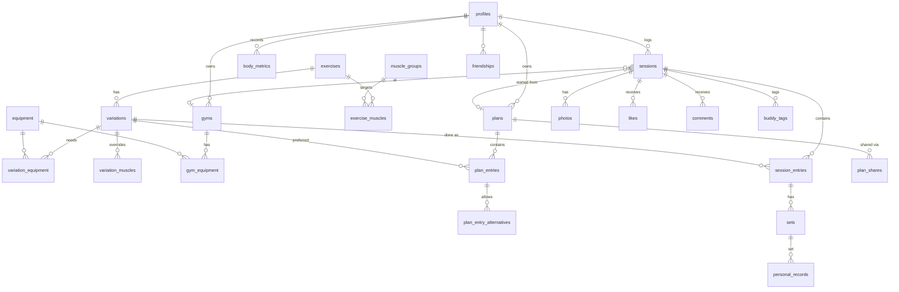

# Lymbr — Data Model

**Version**: 1.0
**Created**: 2026-11-02
**Status**: Draft for review
**Related**: `specs.md` (Key Entities, FRs), `rules.md` §2–3 (data and privacy rules), `architecture.md` §6 (sync design)

This document defines every table, column, relationship, index, and row-level security (RLS) policy in Supabase Postgres, plus what syncs to the phone through PowerSync. Migrations in `supabase/migrations/` must match this file. If they need to differ, update this file in the same PR.

---

## 1. Conventions

| Rule | Detail |
|---|---|
| Primary keys | `id uuid`, generated on the client (`crypto.randomUUID()`) so rows can be created offline. Library rows get server-generated UUIDs. |
| Standard columns | Every user-owned table has `id`, `owner_id`, `created_at`, `updated_at`, `deleted_at`. |
| `owner_id` everywhere | Child tables (e.g., `sets`) also store `owner_id`, even though it could be derived. This keeps RLS and PowerSync Sync Streams simple and fast. |
| Join tables | Join tables (`exercise_muscles`, `variation_equipment`, `variation_muscles`, `gym_equipment`) also have an `id uuid` primary key, because PowerSync needs a single `id` column on every synced table. Their natural two-column key is a unique constraint. |
| Timestamps | `timestamptz`. `updated_at` is set by a trigger on the server (avoids phone clock drift). |
| Soft deletes | Synced tables are never hard-deleted by users; set `deleted_at`. A nightly job purges rows deleted more than 30 days ago. |
| Naming | Plural `snake_case` tables, `snake_case` columns, `_id` suffix for foreign keys. |
| Enums | Postgres enums (section 2). |
| Money of weights | Weights use `numeric(7,3)`. Never rounded when stored. |

---

## 2. Enums

| Enum | Values |
|---|---|
| `weight_unit` | `kg`, `lb`, `stack` |
| `visibility` | `private`, `friends` |
| `content_source` | `wger`, `custom` |
| `tracking_type` | `weight_reps`, `reps_only`, `duration`, `distance`, `duration_distance` |
| `set_type` | `warmup`, `working`, `drop`, `failure` |
| `muscle_role` | `primary`, `secondary` |
| `session_status` | `active`, `finished` |
| `entry_origin` | `planned`, `added` |
| `entry_status` | `pending`, `done`, `skipped` |
| `record_type` | `heaviest`, `rep_at_weight`, `session_volume` |
| `friendship_status` | `pending`, `accepted`, `declined`, `blocked` |
| `buddy_status` | `pending`, `accepted`, `declined` |
| `recovery_override` | `recovered`, `not_recovered` |
| `notification_type` | `friend_request`, `friend_accepted`, `like`, `comment`, `plan_shared`, `buddy_invite`, `buddy_accepted`, `streak_milestone`, `plan_reminder` |

---

## 3. Entity-relationship overview



---

## 4. Tables

Legend: **PK** primary key · **FK** foreign key · **U** unique · **NN** not null. Standard columns (`created_at`, `updated_at`, `deleted_at`) are omitted from the tables below unless noted.

### 4.1 Accounts

#### `profiles`
One row per user. `id` equals `auth.users.id`.

| Column | Type | Notes |
|---|---|---|
| id | uuid PK, FK → auth.users | |
| username | citext U NN | 3–20 chars, `[a-z0-9_]`. Used for friend search. |
| display_name | text NN | |
| avatar_path | text | Path in `avatars` bucket. |
| default_unit | weight_unit NN | `kg` or `lb`; default `kg`. |
| display_unit | weight_unit NN | Unit used in charts; default `kg`. |
| week_start | smallint NN | 0 = Sunday … 6 = Saturday; default 1 (Monday). |
| timezone | text NN | IANA name, e.g. `Asia/Manila`. |
| weekly_goal | smallint | Current sessions-per-week goal, 1–14. Null = no goal. Mirrors the latest `weekly_goals` row. |
| streak_visibility | visibility NN | Default `private`. |
| current_streak_weeks | integer NN | Default 0. Maintained by server function (§6.3). |
| best_streak_weeks | integer NN | Default 0. |
| volume_guide_min | smallint NN | Default 10 sets/muscle/week. |
| volume_guide_max | smallint NN | Default 20. |
| notification_settings | jsonb NN | e.g. `{"like":true,"comment":true,"plan_reminder":false}`. |
| onboarded_at | timestamptz | Null until onboarding finished or skipped. |

#### `weekly_goals`
Goal history, so changing the goal never rewrites past weeks (US10 scenario 3).

| Column | Type | Notes |
|---|---|---|
| id | uuid PK | Deterministic: UUID v5 of `owner_id` + `effective_from` (namespace constant in `packages/shared`). Two devices setting the same week's goal offline write the same row, so they merge instead of colliding. |
| owner_id | uuid FK NN | |
| goal | smallint | 1–14, or null for "no goal". |
| effective_from | date NN | First day of the week the goal starts. U with owner_id. |

Synced in `user_data`. Changing the goal mid-week updates that week's row (same `id`).

#### `push_tokens`

Not synced. Registered with an upsert on `token` (`api.md` §4.8).

| Column | Type | Notes |
|---|---|---|
| id | uuid PK | Server default `gen_random_uuid()`. |
| owner_id | uuid FK → profiles NN | |
| token | text U NN | Expo push token. Upsert conflict target. |
| platform | text NN | `ios` / `android`. |
| last_seen_at | timestamptz NN | |

#### `app_config`
Single-row table for app-wide settings. Readable by everyone (including signed-out), writable only by the service role.

| Column | Type | Notes |
|---|---|---|
| id | smallint PK | Always 1. |
| min_supported_version | text NN | e.g. `1.0.0`. Older apps are asked to update (`api.md` §9). |

### 4.2 Exercise library

**wger mapping.** wger groups related exercises under a shared "variations" ID. On import, each wger variation group becomes one Lymbr **exercise**, and each wger exercise in the group becomes a **variation**. A wger exercise without a group becomes an exercise with a single variation. *(Verify against the current wger API during the import task.)*

#### `muscle_groups`
Fixed seed list used by the body map and volume tracking.

| Column | Type | Notes |
|---|---|---|
| id | smallint PK | |
| slug | text U NN | `chest`, `upper_back`, `lats`, `traps`, `front_delts`, `side_delts`, `rear_delts`, `biceps`, `triceps`, `forearms`, `abs`, `obliques`, `lower_back`, `glutes`, `quads`, `hamstrings`, `adductors`, `calves` |
| name | text NN | Display name. |
| body_side | text NN | `front`, `back`, or `both`. |
| svg_region_ids | text[] NN | IDs of paths in the body-map SVG. |

#### `wger_muscle_map`

| Column | Type | Notes |
|---|---|---|
| wger_muscle_id | integer PK | |
| muscle_group_id | smallint FK → muscle_groups NN | |

#### `equipment`

| Column | Type | Notes |
|---|---|---|
| id | uuid PK | |
| owner_id | uuid FK → profiles | Null = standard (library) equipment. |
| name | text NN | e.g. "Smith machine", "Cable station", "Dumbbells". |
| wger_id | integer U | |

#### `exercises`

| Column | Type | Notes |
|---|---|---|
| id | uuid PK | |
| owner_id | uuid FK → profiles | Null for library exercises. |
| source | content_source NN | |
| wger_group_id | integer U | wger variation-group ID, if any. |
| name | text NN | |
| description | text | |
| category | text | e.g. Chest, Legs. |
| image_url | text | |
| is_active | boolean NN | Default true. Library items removed upstream become false; never deleted. |

#### `exercise_muscles`

| Column | Type | Notes |
|---|---|---|
| id | uuid PK | |
| exercise_id | uuid FK → exercises NN | |
| muscle_group_id | smallint FK → muscle_groups NN | |
| role | muscle_role NN | |
| owner_id | uuid | Copied from exercise (null for library). |
| U | (exercise_id, muscle_group_id) | |

Custom exercises must have at least one `primary` row (enforced in app and by a deferred constraint trigger).

#### `variations`

| Column | Type | Notes |
|---|---|---|
| id | uuid PK | |
| exercise_id | uuid FK → exercises NN | |
| owner_id | uuid FK → profiles | Null for library variations. |
| source | content_source NN | |
| wger_exercise_id | integer U | |
| name | text NN | e.g. "Smith Incline Press". |
| tracking_type | tracking_type NN | Default `weight_reps`. |
| default_unit | weight_unit | Null = use user's default / last used. |
| uses_bodyweight | boolean NN | Pull-ups, dips. Default false. |
| is_assisted | boolean NN | Assisted machine: logged weight is assistance. Default false. |
| is_unilateral | boolean NN | Allows left/right reps. Default false. |
| image_url | text | |
| is_active | boolean NN | Default true. |

#### `variation_equipment`

| Column | Type | Notes |
|---|---|---|
| id | uuid PK | |
| variation_id | uuid FK → variations NN | |
| equipment_id | uuid FK → equipment NN | |
| owner_id | uuid | Null for library. |
| U | (variation_id, equipment_id) | |

#### `variation_muscles`
Optional override. If a variation has no rows here, it uses its exercise's muscles.

| Column | Type | Notes |
|---|---|---|
| id | uuid PK | |
| variation_id | uuid FK → variations NN | |
| muscle_group_id | smallint FK NN | |
| role | muscle_role NN | |
| owner_id | uuid NN | Overrides are always user-owned. |
| U | (variation_id, muscle_group_id) | |

### 4.3 Gyms

#### `gyms`

| Column | Type | Notes |
|---|---|---|
| id | uuid PK | |
| owner_id | uuid FK NN | |
| name | text NN | |
| equipment_configured | boolean NN | False = don't filter suggestions by equipment (FR-083, US8 scenario 4). |
| last_used_at | timestamptz | Used for the default gym. |

#### `gym_equipment`

| Column | Type | Notes |
|---|---|---|
| id | uuid PK | |
| gym_id | uuid FK → gyms NN | |
| equipment_id | uuid FK → equipment NN | |
| owner_id | uuid NN | |
| learned | boolean NN | True when added automatically because a variation was used here (FR-084). |
| U | (gym_id, equipment_id) | |

### 4.4 Plans

#### `plans`

| Column | Type | Notes |
|---|---|---|
| id | uuid PK | |
| owner_id | uuid FK NN | |
| name | text NN | |
| notes | text | |
| visibility | visibility NN | Default `private`. `friends` = all friends can view. |
| schedule_days | smallint[] | Days of week (0–6). Null/empty = unscheduled. |
| reminder_enabled | boolean NN | Default false. |
| reminder_time | time | Local time for the reminder. |
| copied_from_plan_id | uuid | Not an FK (source may be deleted). |
| copied_from_user_id | uuid | For "Copied from @friend". |
| archived_at | timestamptz | |

#### `plan_entries`

| Column | Type | Notes |
|---|---|---|
| id | uuid PK | |
| owner_id | uuid NN | |
| plan_id | uuid FK → plans NN | |
| position | integer NN | Order in the plan. |
| exercise_id | uuid FK → exercises NN | |
| preferred_variation_id | uuid FK → variations NN | Must belong to `exercise_id`. |
| target_sets | smallint | |
| target_reps_min | smallint | |
| target_reps_max | smallint | |
| notes | text | |

#### `plan_entry_alternatives`

| Column | Type | Notes |
|---|---|---|
| id | uuid PK | |
| owner_id | uuid NN | |
| plan_entry_id | uuid FK NN | |
| variation_id | uuid FK NN | May be from another exercise that hits the same muscles. |
| position | integer NN | Order of preference. |

#### `plan_shares`
Share a plan with one specific friend. (Sharing with all friends uses `plans.visibility = friends`.)

| Column | Type | Notes |
|---|---|---|
| id | uuid PK | |
| owner_id | uuid NN | Plan owner. |
| plan_id | uuid FK NN | |
| recipient_id | uuid FK → profiles NN | |
| U | (plan_id, recipient_id) | |

### 4.5 Sessions and sets

#### `sessions`

| Column | Type | Notes |
|---|---|---|
| id | uuid PK | |
| owner_id | uuid FK NN | |
| status | session_status NN | |
| plan_id | uuid FK → plans | Source plan, if any. `on delete set null`. |
| plan_name_snapshot | text | Plan name at the time, so history reads well after a rename/delete. |
| source_session_id | uuid | Set when started with "Repeat". |
| gym_id | uuid FK → gyms | `on delete set null`. |
| started_at | timestamptz NN | |
| ended_at | timestamptz | |
| local_date | date NN | Date in the user's timezone at `started_at`. Used by calendar and streaks. |
| timezone | text NN | IANA timezone when logged. |
| notes | text | |
| visibility | visibility NN | Default `private`. |
| hide_gym | boolean NN | Default false. Hides gym name from friends (FR-108). |
| cover_photo_id | uuid | FK → photos, deferrable. |
| deviated_from_plan | boolean NN | Default false. |

#### `session_entries`
One exercise as actually done in a session. Snapshot of the plan at start, then edited freely.

| Column | Type | Notes |
|---|---|---|
| id | uuid PK | |
| owner_id | uuid NN | |
| session_id | uuid FK → sessions NN | |
| position | integer NN | |
| exercise_id | uuid FK NN | |
| variation_id | uuid FK NN | Variation actually used. |
| plan_entry_id | uuid | Link to the plan entry it came from (not an FK). |
| swapped_from_variation_id | uuid | The plan's variation, if swapped. |
| origin | entry_origin NN | `planned` = copied in at start (from a plan, a past session, or a buddy invite); `added` = added during the session. Never changes. |
| status | entry_status NN | Default `pending`. `done` once a set is logged; `skipped` when the user skips it. |
| notes | text | |

#### `sets`

| Column | Type | Notes |
|---|---|---|
| id | uuid PK | |
| owner_id | uuid NN | |
| session_id | uuid FK NN | Denormalised for fast queries. |
| session_entry_id | uuid FK NN | |
| variation_id | uuid FK NN | Denormalised for "Last time" and PRs. |
| position | integer NN | |
| set_type | set_type NN | Default `working`. |
| weight_value | numeric(7,3) | As entered. For bodyweight variations: added load. For assisted: assistance amount. |
| weight_unit | weight_unit | Required when `weight_value` is set. |
| weight_kg | numeric(8,3) | Computed: converted load; for bodyweight variations = bodyweight + added (or − assistance). Null for `stack`. |
| bodyweight_kg | numeric(6,2) | Bodyweight snapshot used for bodyweight variations. |
| reps | smallint | |
| reps_left | smallint | Unilateral only. |
| reps_right | smallint | Unilateral only. |
| duration_seconds | integer | |
| distance_m | numeric(9,2) | |
| rpe | numeric(3,1) | 1–10, half steps. |
| rir | smallint | 0–10. Either RPE or RIR, not both. |
| note | text | |
| completed_at | timestamptz NN | |

Checks:
- `weight_unit = 'stack'` ⇒ `weight_kg is null`.
- `weight_value is not null` ⇒ `weight_unit is not null`.
- Not both `rpe` and `rir`.

`weight_kg` is computed in `packages/shared` on device (so it works offline) and re-checked by a server trigger.

#### `personal_records`
Current and past PRs per variation. Written on device when a set is saved (US5).

| Column | Type | Notes |
|---|---|---|
| id | uuid PK | |
| owner_id | uuid NN | |
| variation_id | uuid FK NN | |
| set_id | uuid FK → sets | Null for `session_volume`. |
| session_id | uuid FK NN | |
| record_type | record_type NN | |
| unit_group | text NN | `mass` (kg/lb compared in kg) or `stack`. |
| weight_kg | numeric(8,3) | For `heaviest` and `rep_at_weight` in `mass`. |
| stack_level | numeric(7,3) | For `heaviest` and `rep_at_weight` in `stack`. |
| reps | smallint | For `rep_at_weight`. |
| volume_kg | numeric(10,2) | For `session_volume` in `mass`. |
| stack_volume | numeric(10,2) | For `session_volume` in `stack`: sum of stack level × reps. |
| achieved_on | date NN | Session's `local_date`. |
| superseded_at | timestamptz | Set when beaten; null = current record. |

Rep PRs are stored per weight: the best reps at each distinct `weight_kg` (or stack level).

Session volume is tracked per unit group: `mass` volume in kg, and `stack` volume as stack level × reps. A stack volume is only compared with other stack sessions of the same variation. A session that mixes kg/lb and stack sets on one variation is checked once per group.

PRs are re-derivable from `sets`. If a set is edited, deleted, or back-dated, the app recomputes PRs for that variation (§6.2).

#### `photos`

| Column | Type | Notes |
|---|---|---|
| id | uuid PK | |
| owner_id | uuid NN | |
| session_id | uuid FK NN | Max 5 live photos per session (trigger). |
| storage_path | text NN | `session-photos/{owner_id}/{session_id}/{id}.jpg` |
| visibility | visibility NN | Default `private`, per photo. |
| is_cover | boolean NN | Max one per session (partial unique index). |
| width | integer | |
| height | integer | |

Upload state (pending/uploaded/failed) is local-only on the phone (PowerSync attachment queue); it isn't stored in Postgres.

### 4.6 Body, nutrition, recovery (always private)

#### `body_metrics`

| Column | Type | Notes |
|---|---|---|
| id | uuid PK | |
| owner_id | uuid NN | |
| measured_on | date NN | |
| weight_value | numeric(6,2) | |
| weight_unit | weight_unit | `kg` or `lb` only. |
| weight_kg | numeric(6,2) | |
| height_cm | numeric(5,1) | |
| session_id | uuid | Optional link to a session. |

At least one of weight or height must be set.

#### `nutrition_logs`

| Column | Type | Notes |
|---|---|---|
| id | uuid PK | |
| owner_id | uuid NN | |
| log_date | date NN | U with owner_id |
| calories | integer | |
| protein_g | numeric(6,1) | |
| carbs_g | numeric(6,1) | |
| fat_g | numeric(6,1) | |
| note | text | |

#### `recovery_inputs`

| Column | Type | Notes |
|---|---|---|
| id | uuid PK | |
| owner_id | uuid NN | |
| recorded_at | timestamptz NN | |
| readiness | smallint | 1–5. |

#### `muscle_soreness`

| Column | Type | Notes |
|---|---|---|
| id | uuid PK | |
| owner_id | uuid NN | |
| recovery_input_id | uuid FK NN | |
| muscle_group_id | smallint FK NN | |
| soreness | smallint | 0–3. |
| override | recovery_override | Manual "recovered / not recovered". |

### 4.7 Social (online only, not synced)

#### `friendships`
One row per pair of users.

| Column | Type | Notes |
|---|---|---|
| id | uuid PK | |
| requester_id | uuid FK NN | |
| addressee_id | uuid FK NN | |
| status | friendship_status NN | |
| blocked_by | uuid | Who blocked, when `status = blocked`. |
| responded_at | timestamptz | |
| U | (least(requester_id, addressee_id), greatest(…)) | One row per pair. |

#### `likes`

| Column | Type | Notes |
|---|---|---|
| id | uuid PK | |
| session_id | uuid FK NN | |
| user_id | uuid FK NN | |
| U | (session_id, user_id) | |

#### `comments`

| Column | Type | Notes |
|---|---|---|
| id | uuid PK | |
| session_id | uuid FK NN | |
| user_id | uuid FK NN | Author. |
| body | text NN | 1–1000 chars. |
| edited_at | timestamptz | |
| deleted_at | timestamptz | Soft delete by author or session owner. |

#### `buddy_tags`

| Column | Type | Notes |
|---|---|---|
| id | uuid PK | |
| owner_id | uuid NN | Session owner who tagged. |
| session_id | uuid FK NN | |
| tagged_user_id | uuid FK NN | |
| status | buddy_status NN | |
| created_session_id | uuid | Session created for the buddy on accept. |
| U | (session_id, tagged_user_id) | |

#### `streak_milestones`
Feed items for public streak milestones.

| Column | Type | Notes |
|---|---|---|
| id | uuid PK | |
| owner_id | uuid NN | |
| weeks | integer NN | 4, 12, 26, 52, then every 52. |
| reached_on | date NN | |

#### `notifications`

| Column | Type | Notes |
|---|---|---|
| id | uuid PK | |
| recipient_id | uuid FK NN | |
| actor_id | uuid FK | |
| type | notification_type NN | |
| session_id / comment_id / plan_id / friendship_id / buddy_tag_id | uuid | Whichever applies. |
| read_at | timestamptz | |
| pushed_at | timestamptz | Set by NestJS after sending. |

---

## 5. Indexes

| Table | Index | Supports |
|---|---|---|
| sessions | (owner_id, local_date desc) | Calendar, streaks, feed |
| sessions | (visibility, owner_id, started_at desc) where visibility = 'friends' | Friends' feed |
| session_entries | (session_id, position) | Session detail |
| sets | (owner_id, variation_id, completed_at desc) | "Last time", progression, PRs |
| sets | (session_entry_id, position) | Session detail |
| personal_records | (owner_id, variation_id, record_type) where superseded_at is null | Current PRs |
| plan_entries | (plan_id, position) | Plan view |
| exercises | GIN trigram on name | Library search |
| variations | GIN trigram on name; (exercise_id) | Search, exercise view |
| body_metrics | (owner_id, measured_on) | Body-weight chart |
| friendships | (requester_id, status), (addressee_id, status) | Friend lists |
| comments | (session_id, created_at) | Comment thread |
| notifications | (recipient_id, read_at, created_at desc) | Inbox |
| photos | unique (session_id) where is_cover and deleted_at is null | One cover per session |

On the phone, PowerSync creates matching local indexes for the synced tables (defined in the client schema).

---

## 6. Server functions and triggers

### 6.1 Helper functions (used by RLS)

All `security definer`, `stable`, with a fixed `search_path`.

- `are_friends(a uuid, b uuid) → boolean`: an `accepted` friendship row exists for the pair.
- `is_blocked(a uuid, b uuid) → boolean`: a `blocked` row exists for the pair.
- `can_view_session(session_id uuid) → boolean`: caller is the owner, **or** the session has `visibility = 'friends'`, `deleted_at is null`, the caller and owner are friends, and neither has blocked the other.
- `can_view_plan(plan_id uuid) → boolean`: caller is the owner, **or** they are friends and not blocked, **and** either the plan has `visibility = 'friends'` or a `plan_shares` row exists for the caller.
- `can_view_variation(variation_id uuid) → boolean`: the variation is a library row (`owner_id is null`), **or** the caller owns it, **or** a non-deleted row that the caller can view references it: a `session_entries` row (`variation_id` or `swapped_from_variation_id`) where `can_view_session(session_id)`, or a `plan_entries` row (`preferred_variation_id`) or `plan_entry_alternatives` row (`variation_id`) where `can_view_plan(plan_id)`. Friends therefore see a custom exercise or variation only when it appears in something shared with them.

### 6.2 Triggers

| Trigger | Table(s) | Purpose |
|---|---|---|
| `set_updated_at` | all synced tables | Server sets `updated_at = now()`. |
| `check_weight_kg` | sets, body_metrics | Recompute and correct `weight_kg` from value and unit. |
| `max_five_photos` | photos | Reject a 6th live photo per session. |
| `entry_variation_matches_exercise` | session_entries, plan_entries | Variation must belong to the exercise. |
| `custom_exercise_needs_primary` | exercises, exercise_muscles | Deferred check: custom exercise has a primary muscle. |
| `notify_on_social` | likes, comments, friendships, buddy_tags, plan_shares | Insert into `notifications`; a database webhook then calls NestJS for the push. |
| `refresh_streak` | sessions | After insert/update/soft-delete, recompute streak (§6.3). |

### 6.3 Streak calculation

`recompute_streak(user_id)` counts consecutive weeks (by `profiles.week_start` and `timezone`) where finished, non-deleted sessions ≥ the goal in effect that week (from `weekly_goals`). Weeks with no goal don't count and don't break the streak. The current, unfinished week counts only if the goal is already met; otherwise the streak carries from last week (so it never "breaks" mid-week). Updates `current_streak_weeks` / `best_streak_weeks` and inserts `streak_milestones` rows when a milestone is crossed and `streak_visibility = friends`.

The same logic exists in `packages/shared` so the phone shows the streak offline. The server value is the one friends see.

### 6.4 RPCs (detail in `api.md`)

- `send_friend_request(username)`, `respond_friend_request(id, accept)`, `remove_friend(user_id)`, `block_user(user_id)`
- `copy_plan(plan_id)`: copies plan, entries, alternatives, and any custom exercises/variations into caller's account; sets `copied_from_*`.
- `respond_buddy_tag(id, accept)`: on accept, creates a session for the buddy with the same entries and empty sets.
- `get_feed(before timestamptz, limit int)`: friends' shared sessions + streak milestones, newest first.
- `delete_account()`: marks the account for deletion; NestJS removes storage objects and rows.

---

## 7. Row-level security policies

RLS is enabled on **every** table (`rules.md` §3). `auth.uid()` = the caller.

| Table | SELECT | INSERT / UPDATE / DELETE |
|---|---|---|
| profiles | Any signed-in user can read `username`, `display_name`, `avatar_path` (via a `public_profiles` view). Streak columns only if owner or (`streak_visibility = friends` and `are_friends`). All other columns owner only. | Owner only. |
| push_tokens | Owner | Owner |
| muscle_groups, wger_muscle_map | All signed-in | None (service role only) |
| equipment, exercises, variations, exercise_muscles, variation_equipment | Library rows (`owner_id is null`): all signed-in. Custom rows: owner, or when `can_view_variation` is true for a related variation: `variations` the row itself; `exercises` and `exercise_muscles` any variation of the exercise; `variation_equipment` its variation; `equipment` any variation linked to it through `variation_equipment`. | Owner for custom rows; library rows service role only. |
| variation_muscles | Owner, or `can_view_variation(variation_id)` | Owner |
| gyms, gym_equipment | Owner | Owner |
| plans | `can_view_plan(id)` | Owner |
| plan_entries, plan_entry_alternatives | `can_view_plan(plan_id)` | Owner |
| plan_shares | Owner or recipient | Owner (recipient must be a friend) |
| sessions | `can_view_session(id)`; gym hidden from non-owners via the feed RPC when `hide_gym` | Owner |
| session_entries, sets, personal_records | `can_view_session(session_id)` | Owner |
| photos | Owner, or (`visibility = friends` and `can_view_session(session_id)`) | Owner |
| body_metrics, nutrition_logs, recovery_inputs, muscle_soreness | **Owner only** | Owner only |
| friendships | Either party | Via RPCs only |
| likes | `can_view_session(session_id)` | Insert/delete own, only where `can_view_session` |
| comments | `can_view_session(session_id)` | Insert own where `can_view_session`; update own; soft-delete own or as session owner |
| buddy_tags | Owner or tagged user | Owner inserts (tagged user must be a friend); tagged user responds via RPC |
| streak_milestones | Owner, or friends when owner's `streak_visibility = friends` | Server only |
| notifications | Recipient | Recipient may update `read_at`; inserts by triggers only |

### Storage policies

- **`session-photos`** (private): path `{owner_id}/{session_id}/{photo_id}.jpg`. Upload/delete: owner only (first path segment = `auth.uid()`). Read: owner, or the matching `photos` row passes the photos SELECT policy. Clients request short-lived signed URLs.
- **`avatars`** (private): owner writes; any signed-in user reads.

Every policy above needs tests proving allowed **and** denied access (`rules.md` §6), including: non-friend, pending friend, blocked user, private session, shared session with a private photo.

---

## 8. Sync (PowerSync)

PowerSync **Sync Streams** define what syncs (`powersync/sync-config.yaml`). Sync Streams are GA and replace PowerSync's older Sync Rules, which are deprecated.

Replication setup lives in `supabase/migrations/0000_powersync.sql`: the `powersync` publication (all tables) and the `powersync_role` that hosted PowerSync instances connect as. The role's password is set by hand once per hosted environment, never in a migration. The local PowerSync service (`powersync/docker-compose.yaml`) connects as the local `postgres` user.

### 8.1 What syncs

| Stream | Contents | Who gets it |
|---|---|---|
| `library` | `muscle_groups`, `wger_muscle_map`, and library rows (`owner_id is null`) of `equipment`, `exercises`, `variations`, `exercise_muscles`, `variation_equipment` where active | Every user |
| `user_data` | All rows the user owns in: `profiles` (own row), `weekly_goals`, custom `equipment`/`exercises`/`variations`/`exercise_muscles`/`variation_equipment`/`variation_muscles`, `gyms`, `gym_equipment`, `plans`, `plan_entries`, `plan_entry_alternatives`, `sessions`, `session_entries`, `sets`, `personal_records`, `photos`, `body_metrics`, `nutrition_logs`, `recovery_inputs`, `muscle_soreness` | That user only |
| Not synced | `friendships`, `likes`, `comments`, `plan_shares`, `buddy_tags`, `streak_milestones`, `notifications`, `push_tokens`, friends' data | Fetched online |

Soft-deleted rows still sync (so deletes reach other devices); the app filters `deleted_at is null` in queries.

Sketch of `powersync/sync-config.yaml` (Sync Streams):

```yaml
config:
  edition: 3

streams:
  library:
    auto_subscribe: true
    queries:
      - SELECT * FROM exercises WHERE owner_id IS NULL AND is_active
      - SELECT * FROM variations WHERE owner_id IS NULL AND is_active
      - SELECT * FROM muscle_groups
      # …other library tables
  user_data:
    auto_subscribe: true
    queries:
      - SELECT * FROM sessions WHERE owner_id = auth.user_id()
      - SELECT * FROM sets WHERE owner_id = auth.user_id()
      # …every user-owned table, same pattern
```

### 8.2 Writes from the phone

- The app writes to local SQLite; PowerSync queues the change.
- The upload connector sends each change to Supabase (upsert by `id`, or soft delete) using the user's JWT, so **RLS applies to every synced write**.
- Same-row conflicts: last write wins (server `updated_at`), which in practice means the last upload wins. Accepted for v1 (`architecture.md` §10). Separate rows per set keep real conflicts rare.

### 8.3 Local type mapping

SQLite on the phone has fewer types than Postgres:

| Postgres | Local (PowerSync) |
|---|---|
| uuid, text, citext, enums, date, time, timestamptz | text |
| integer, smallint, boolean | integer (boolean as 0/1) |
| numeric | real (display rounding only; comparisons use `weight_kg`) |
| arrays (`schedule_days`, `svg_region_ids`) | text (JSON) |
| jsonb | text (JSON) |

---

## 9. Derived values (not stored, computed in `packages/shared`)

| Value | Inputs | Used by |
|---|---|---|
| "Last time" | latest finished session's sets for a variation | US5 |
| Top weight / volume over time | `sets` (working + drop + failure, not warm-up) | US7 |
| Weekly sets per muscle | `sets` × muscles (primary 1, secondary 0.5) | US9 |
| Recovery estimate | last training per muscle, volume, failure sets, `muscle_soreness`, `readiness` | US9 |
| Weekly goal progress | finished sessions this week | US10 |
| Swap suggestions | plan alternatives, variations, gym equipment, user history | US8 |

---

## 10. Open items to verify during build

- Confirm wger's current variation-group field and muscle IDs when writing the import (`wger_muscle_map` seed).
- Confirm PowerSync's attachment helper for photos. (Sync Streams were chosen over the deprecated Sync Rules in November 2026.)
- Tables with non-uuid keys (`muscle_groups`, `wger_muscle_map`) need their key exposed as a text `id` column in the stream query.
- Decide purge window for soft-deleted rows (30 days proposed).
