# Lymbr — Flows

**Version**: 1.0
**Created**: 2026-11-02
**Status**: Draft for review
**Related**: `specs.md` (user stories), `architecture.md` §5, `data-model.md`, `api.md`

Step-by-step flows for Lymbr's important and tricky behaviours. Each flow has a sequence diagram and numbered steps. Simple screens (e.g., editing a gym's name) are left out.

**Participants used in diagrams**

| Name | Meaning |
|---|---|
| User | The person using the app |
| App | Mobile app screens and logic |
| Shared | `packages/shared` pure functions (units, PRs, volume, recovery, streaks, suggestions) |
| Local | Local SQLite (PowerSync) on the phone |
| Sync | PowerSync service + upload connector |
| DB | Supabase Postgres (with RLS, triggers, RPCs) |
| Storage | Supabase Storage |
| API | NestJS service |
| Push | Expo Push service |

## Contents

1. Onboarding
2. Start a session (from a plan, at a gym)
3. Log a set ("Last time" + PR detection)
4. Today's Swap (swap suggestions)
5. Finish a session
6. Offline sync and conflicts
7. Photo upload
8. Edit, delete or back-date a set (PR recompute)
9. Recovery estimate and soreness input
10. Repeat a session / save as plan
11. Streaks and weekly goal
12. Friend request
13. Share a session → feed → like/comment → notification
14. Copy a friend's plan
15. Gym buddy invite
16. Data export
17. Account deletion
18. wger library import
19. State diagrams (session, friendship, buddy tag, photo upload)

---

## 1. Onboarding

**Stories**: US4 · **FRs**: FR-001–003, FR-110

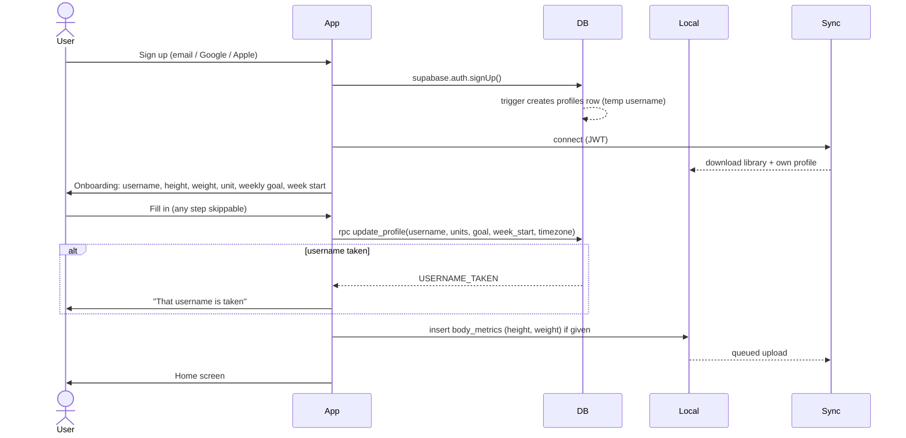

**Steps**

1. User signs up. A database trigger creates their `profiles` row with a temporary username.
2. PowerSync connects and downloads the exercise library, so search works offline from the first session.
3. Onboarding asks for username, height, weight, default unit, weekly goal and week start. Timezone is detected from the device. Every step except username can be skipped.
4. Username is saved online via `update_profile` (needs a uniqueness check). If the user is offline, the temporary username is kept and they're asked again later.
5. Height and weight become the first `body_metrics` row, written locally and synced.

**Edge cases**: no network during onboarding (finish later, logging still works); user skips everything (defaults: kg, Monday, no goal).

---

## 2. Start a session (from a plan, at a gym)

**Stories**: US1, US3, US8 · **FRs**: FR-030, FR-035, FR-081–083

```mermaid
sequenceDiagram
  actor User
  participant App
  participant Local
  participant Shared

  User->>App: Tap "Start" on Push Day
  App->>Local: get default gym (last used)
  App->>User: Confirm gym (Gym A ▾)
  User->>App: Choose Gym B
  App->>Local: read plan entries + alternatives
  App->>Local: read Gym B equipment
  App->>Shared: checkAvailability(entries, gymEquipment)
  Shared-->>App: Smith Incline Press needs Smith machine (not at Gym B)
  App->>Shared: suggestSwaps(entry, gym, history)
  Shared-->>App: [Dumbbell Incline Press, Machine Incline Press]
  App->>Local: BEGIN
  App->>Local: insert sessions (status=active, plan_id, plan_name_snapshot, gym_id, started_at, local_date, timezone)
  App->>Local: insert session_entries (copy of each plan entry, status=planned)
  App->>Local: COMMIT
  App->>User: Session screen; flagged entry shows "Not available here: swap?"
```

**Steps**

1. User starts a plan. The app suggests the last-used gym; the user can change it or choose "No gym".
2. The app checks each plan entry's variation equipment against the gym's equipment (only if `equipment_configured` is true).
3. Unavailable variations are **flagged, not auto-swapped**. The user decides (see flow 4).
4. In one local transaction, the app creates the `sessions` row and copies every plan entry into `session_entries` (`status = planned`). This is the snapshot: from now on the session never reads from the plan.
5. Works fully offline.

**Variants**

- **Empty session**: same, with no entries. User adds exercises as they go (`status = added`).
- **Repeat**: entries copied from a past session instead of a plan (flow 10).
- **Scheduled plan**: on a scheduled day, Home shows "Today: Push Day", which starts this flow.

**Edge cases**: an active session already exists (offer to resume it or finish it first); plan was edited on another device but not yet synced (the snapshot uses whatever is local).

---

## 3. Log a set ("Last time" + PR detection)

**Stories**: US1, US5 · **FRs**: FR-033–034, FR-040–041

```mermaid
sequenceDiagram
  actor User
  participant App
  participant Local
  participant Shared

  User->>App: Open "Dumbbell Incline Press"
  App->>Local: last finished session's sets for this variation
  Local-->>App: 3 × 10 @ 50 lb (Oct 28, Gym B)
  App->>User: Show "Last time" + pre-fill 50 lb
  User->>App: Enter 55 lb × 8, working, RPE 8
  App->>Shared: validate(set) + toKg(55, lb) = 24.948
  App->>Local: insert sets (weight_value 55, weight_unit lb, weight_kg 24.948, …)
  App->>Local: current PRs for this variation
  App->>Shared: detectPRs(newSet, currentPRs)
  Shared-->>App: heaviest ✔ (beat 22.680 kg)
  App->>Local: BEGIN; set old PR superseded_at; insert new personal_records; COMMIT
  App->>User: 🎉 New PR: heaviest 55 lb
  App->>Local: mark entry status = done
```

**Steps**

1. Opening a variation loads the most recent finished session's sets for **that variation only** and pre-fills weight and unit (the unit last used on this variation).
2. User enters values. The input fields depend on the variation's tracking type (weight × reps, reps only, duration, distance).
3. The app validates with Zod and computes `weight_kg` with `packages/shared` (`1 lb = 0.45359237 kg`). For bodyweight variations it adds the latest body weight (or subtracts assistance).
4. The set is saved locally immediately. No "save session" button is needed for data to be safe.
5. If the set is not a warm-up, PR detection compares it with current records:
   - **heaviest**: higher `weight_kg` (or higher stack level within `stack`);
   - **rep_at_weight**: more reps than ever at this exact `weight_kg`;
   - **session_volume**: checked at session finish (flow 5).
6. New PRs: old record gets `superseded_at`; new record is inserted; the app celebrates.

**Edge cases**: mixed units on one variation (compared in kg); `stack` sets only compared with `stack` sets; first-ever set on a variation (no "Last time", no PR celebration on the very first set, so day one isn't all confetti); a drop set or failure set can still set a PR.

---

## 4. Today's Swap (swap suggestions)

**Stories**: US1, US8 · **FRs**: FR-031, FR-083–084

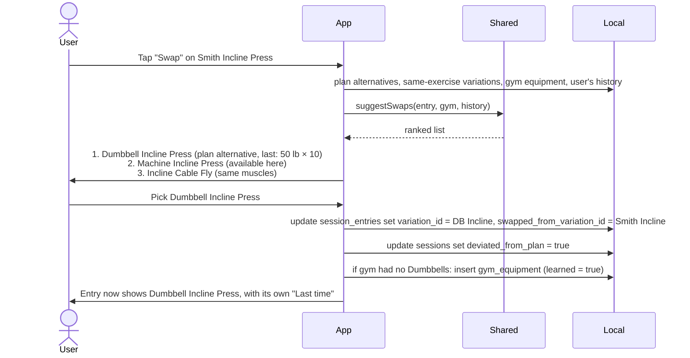

**Ranking (`suggestSwaps`)**

1. The plan entry's alternatives, in the order the user set.
2. Other variations of the same exercise available at this gym.
3. Variations of other exercises with the same primary muscles available at this gym.
4. Within each group, variations the user has history with come first (most recent first).
5. If the gym has no equipment configured, skip equipment filtering.
6. Search is always available for anything else.

**Other session-only changes** (all touch `session_entries` only and set `deviated_from_plan = true`):

| Action | Change |
|---|---|
| Skip | `status = skipped` (kept, so history shows it was skipped) |
| Add exercise | new entry, `status = added` |
| Reorder | update `position` |
| Remove an added exercise | soft-delete the entry (and its sets) |

The plan rows are **never** touched here (`rules.md` §1.7).

---

## 5. Finish a session

**Stories**: US1, US5, US6, US9, US10, US11 · **FRs**: FR-032, FR-036, FR-041, FR-070, FR-101

```mermaid
sequenceDiagram
  actor User
  participant App
  participant Shared
  participant Local

  User->>App: Tap "Finish"
  App->>Local: load session + entries + sets
  App->>Shared: sessionVolume(sets), detectVolumePR(), musclesHit()
  Shared-->>App: volume PR on DB Incline Press; muscles: chest, front delts, triceps
  App->>User: Summary: duration, PRs, body map
  opt session deviated from plan
    App->>User: "Save these changes to Push Day?" [No] / Yes
    alt Yes
      App->>Local: update plan_entries from session entries
    end
  end
  App->>User: Add photos (≤5), pick cover, notes, body weight, visibility (Private ▾)
  User->>App: Visibility = Friends, photo 2 = Friends, cover = photo 2
  App->>Local: update sessions (status=finished, ended_at, visibility, cover_photo_id)
  App->>Local: insert photos rows (flow 7)
  App->>Shared: weeklyGoalProgress(), streak()
  App->>User: "3 / 4 this week · 6-week streak"
```

**Steps**

1. Session volume PRs are checked per variation.
2. The summary shows duration, sets, PRs and the session body map (primary muscles strong, secondary light).
3. **If the session deviated**, the user is asked to save changes to the plan, **default No**. "Yes" maps the session back to the plan:
   - swapped variation → becomes the preferred variation (old one moves to alternatives),
   - skipped → kept in plan (skips are never saved as removals unless the user removes it in the plan editor),
   - added → appended to the plan,
   - new order → applied.
4. User adds optional photos, cover, notes, body weight; chooses visibility. Defaults: session private, each photo private.
5. Session marked `finished`. Local weekly goal and streak update immediately; the server recalculates after sync (flow 11).
6. If visibility is Friends, it appears in friends' feeds once synced (flow 13).

**Edge cases**: finishing with no sets (ask "Discard empty session?"); session left open > 4 hours (prompt on next open: finish with last set time as end, or keep going); visibility can be changed later from the session detail.

---

## 6. Offline sync and conflicts

**Stories**: all · **FRs**: FR-120–124

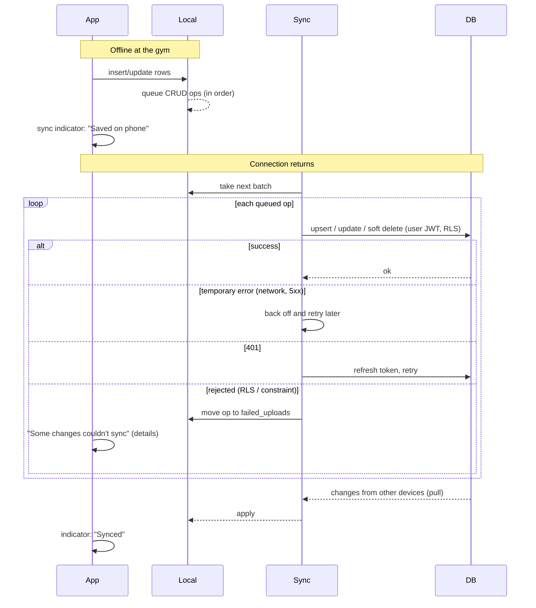

**Rules**

- Every local write is safe the moment it's saved. Sync is background work.
- Ops upload in the order they were made, so a `sets` row never arrives before its `session_entries` row.
- One failed row never blocks the queue and is never silently dropped (`api.md` §3.3).
- **Conflicts**: same row edited on two devices → last write wins by server `updated_at`. Different sets in the same session never conflict (each set is its own row).
- **Delete vs edit**: deletes are soft, so an edit on another device can't resurrect or lose data silently. The row stays recoverable during the purge window.
- Social screens show "You're offline. The feed will load when you're back online." Everything else works normally.

---

## 7. Photo upload

**FRs**: FR-036, FR-122

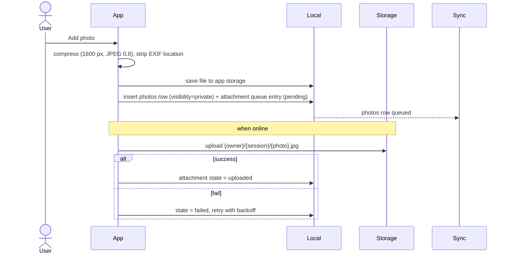

**Rules**: max 5 live photos per session; one cover; the phone shows its local copy until upload finishes; friends only see the photo once uploaded **and** shared; changing a photo's visibility is just a row update (no re-upload).

---

## 8. Edit, delete or back-date a set (PR recompute)

**Stories**: US5, US6 · **FRs**: FR-037, FR-041

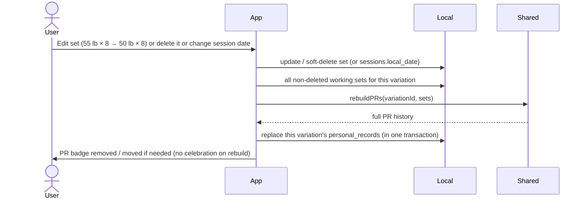

**Rules**

- PRs are rebuilt from sets for the affected variation(s) only, never patched by hand.
- A rebuild never triggers a celebration.
- Back-dating changes `local_date`, which also updates the calendar, weekly goal and streak (flow 11).

---

## 9. Recovery estimate and soreness input

**Stories**: US9 · **FRs**: FR-070–074

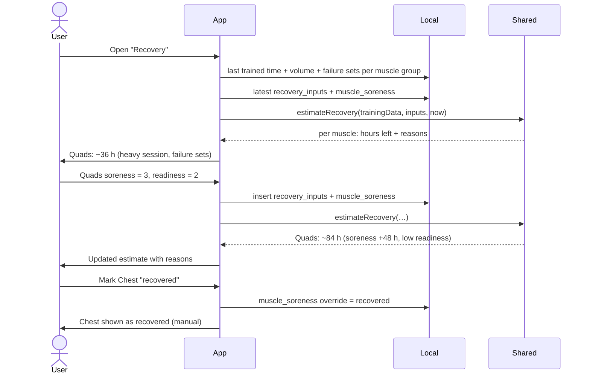

**Rule (from `data-model.md` and FR-074)**: base 48 h, 72 h after high volume or failure sets; +24 h per soreness level above 1; readiness adjusts within limits; manual override wins. Always labelled "guidance, not medical advice". Exact constants live in `packages/shared` and are covered by tests.

**Weekly heatmap**: same data, summing working sets per muscle group this week (primary 1, secondary 0.5), compared with the user's guide range.

---

## 10. Repeat a session / save as plan

**Stories**: US13 · **FRs**: FR-030

```mermaid
sequenceDiagram
  actor User
  participant App
  participant Local

  User->>App: Past session → "Repeat"
  App->>Local: copy its non-skipped entries into a new active session (status=planned, source_session_id)
  App->>User: Session screen with "Last time" from that session
  User->>App: Past session → "Save as plan"
  App->>User: Name the plan
  App->>Local: insert plans + plan_entries (preferred = variation used; target sets = sets done; reps range from sets)
```

Both work offline. "Save as plan" creates a private, unscheduled plan.

---

## 11. Streaks and weekly goal

**Stories**: US10 · **FRs**: FR-090–094

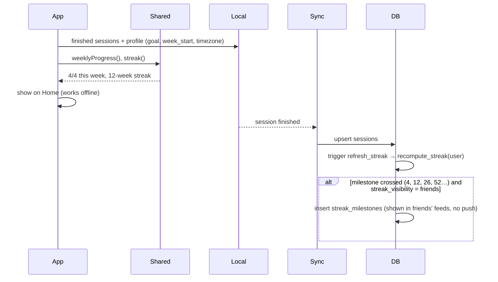

**Rules**

- A week counts if finished sessions in that week (by `local_date`, user's week start) ≥ weekly goal.
- The current week never breaks the streak until it's over.
- Changing the goal applies from the current week: a new `weekly_goals` row is added with `effective_from` = start of this week. Past weeks are always judged against the goal that was in effect then, so changing the goal never rewrites history.
- Milestones appear in friends' feeds only if the streak is public. They don't send push notifications to friends (keeps it low-pressure).
- No "streak lost" shaming. If a streak ends, Home just shows the new week's progress.

---

## 12. Friend request

**Stories**: US11 · **FRs**: FR-100

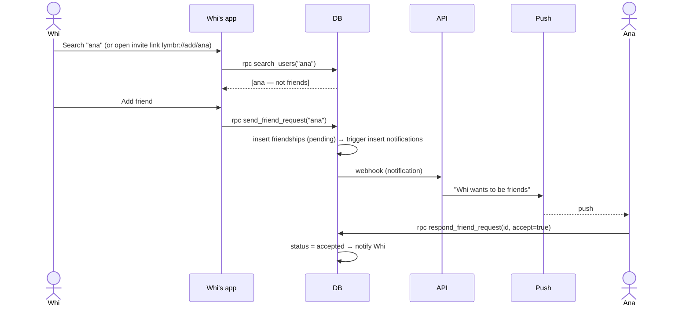

**Rules**: friendship is mutual; if Ana had already requested Whi, Whi's request accepts it; blocked users can't find or request each other; removing or blocking cuts access to shared content immediately (RLS).

---

## 13. Share a session → feed → like/comment → notification

**Stories**: US11 · **FRs**: FR-101–104, FR-108

```mermaid
sequenceDiagram
  actor Whi
  participant WApp as Whi's app
  participant Sync
  participant DB
  participant API
  participant Push
  actor Ana
  participant AApp as Ana's app

  Whi->>WApp: Session visibility = Friends
  WApp->>Sync: update sessions.visibility (queued)
  Sync->>DB: update (RLS: owner)
  Ana->>AApp: Open Feed
  AApp->>DB: rpc get_feed(before=null, limit=20)
  DB-->>AApp: items (only can_view_session = true; private photos excluded; gym hidden if hide_gym)
  AApp->>DB: storage createSignedUrl(cover photo)
  Ana->>AApp: Like + comment "Nice PR!"
  AApp->>DB: insert likes, insert comments (RLS: can_view_session)
  DB->>DB: trigger → notifications for Whi
  DB->>API: webhook
  API->>API: check Whi's notification_settings
  API->>Push: "Ana commented on your Push Day"
  Push-->>Whi: push
```

**Rules**: chronological feed only, no ranking; push text never includes weights or comment text; making a session private again removes it from feeds right away (likes/comments are kept but hidden until shared again).

---

## 14. Copy a friend's plan

**Stories**: US12 · **FRs**: FR-105

```mermaid
sequenceDiagram
  actor Ana
  participant App as Ana's app
  participant DB
  participant Sync
  participant Local

  Ana->>App: Whi's profile → Plans → Push Day
  App->>DB: rpc get_plan_detail(plan_id)
  DB-->>App: plan + entries + alternatives (can_view_plan)
  Ana->>App: "Copy to my plans"
  App->>DB: rpc copy_plan(plan_id)
  DB->>DB: BEGIN: new plan (private, copied_from) + entries + alternatives + copies of Whi's custom exercises/variations; COMMIT
  DB-->>App: { plan_id }
  Sync-->>Local: new rows arrive on Ana's phone
  App->>Ana: "Push Day (copied from @whi)" ready to edit
```

**Rules**: needs a connection; the copy is fully independent (later edits never cross over); Ana's copy starts private and unscheduled; Whi's history and numbers are never copied.

---

## 15. Gym buddy invite

**Stories**: US14 · **FRs**: FR-106

```mermaid
sequenceDiagram
  actor Whi
  participant WApp as Whi's app
  participant DB
  participant Push
  actor Ana
  participant AApp as Ana's app
  participant Sync

  Whi->>WApp: Session → "Trained with…" → Ana
  alt online
    WApp->>DB: rpc tag_buddies(session_id, [ana])
  else offline
    WApp->>WApp: store pending tag locally; send when online
  end
  DB->>DB: insert buddy_tags (pending) + notification
  DB-->>Push: (via API) "Whi tagged you in Push Day"
  Ana->>AApp: Open invite → Accept
  AApp->>DB: rpc respond_buddy_tag(id, accept=true)
  DB->>DB: create Ana's session (same date/time, entries copied as planned, no sets, private)
  DB-->>AApp: { session_id }
  Sync-->>AApp: new session arrives
  AApp->>Ana: Fill in your own sets
```

**Rules**: only friends can be tagged; Ana's session is private by default and has her own numbers; if both sessions are shared, the feed shows "Trained with @ana"; declining creates nothing.

---

## 16. Data export

**Stories**: US16 · **FRs**: FR-130

1. User taps Settings → Export.
2. The app reads all own, non-deleted data from local SQLite (works offline; warns if there are unsynced changes from other devices).
3. Builds:
   - `lymbr-sets.csv`: one row per set (date, session, plan, gym, exercise, variation, set type, weight value, unit, weight_kg, reps, RPE/RIR, note),
   - `lymbr-export.json`: everything (profile, plans, sessions, sets, PRs, gyms, body metrics, nutrition, recovery).
4. Zips them and opens the system share sheet. Photos are not included in v1 (listed by path in the JSON).

---

## 17. Account deletion

**FRs**: FR-004

```mermaid
sequenceDiagram
  actor User
  participant App
  participant DB
  participant API
  participant Storage

  User->>App: Settings → Delete account
  App->>User: Explain what is deleted; offer export first; ask to confirm (type username)
  App->>DB: re-authenticate if sign-in older than 10 min
  App->>DB: rpc delete_account()
  DB->>API: webhook account-deletion
  API->>Storage: delete session-photos/{user}/*, avatars/{user}.jpg
  API->>DB: delete user rows (social rows, then owned rows)
  API->>DB: delete auth user
  App->>App: sign out, wipe local database and files
```

Friends' comments on the user's sessions disappear with the sessions; the user's comments on friends' sessions are deleted too.

---

## 18. wger library import

**FRs**: FR-010–012

```mermaid
sequenceDiagram
  participant Cron as Weekly schedule
  participant API
  participant Wger as wger API
  participant DB
  participant Sync
  participant Local

  Cron->>API: run import
  API->>Wger: GET muscles, equipment, categories, exercises (paginated, English)
  API->>API: map muscles → muscle_groups; group by variation group → exercises / variations
  API->>DB: upsert by wger IDs (service role)
  API->>DB: mark missing items is_active = false (never delete)
  API->>DB: save run summary
  DB-->>Sync: library bucket changed
  Sync-->>Local: phones receive updates in background
```

User history is never affected: sets reference our own variation IDs, and deactivated variations still display in history but don't appear in search.

---

## 19. State diagrams

### Session

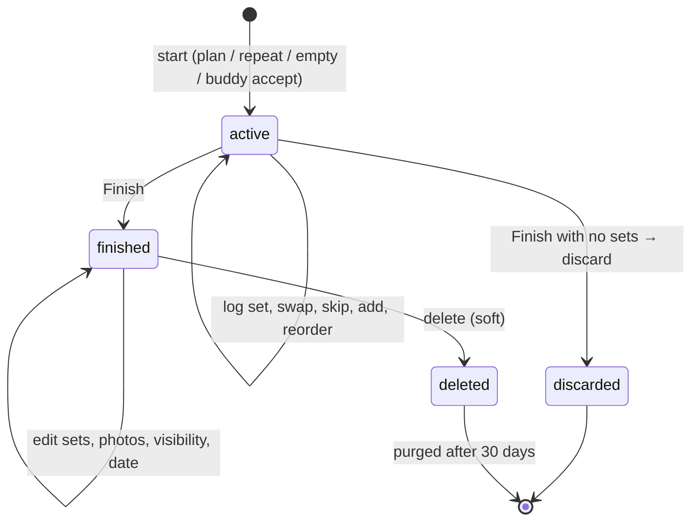

Buddy-accepted sessions start as `active` with planned entries and no sets.

### Friendship

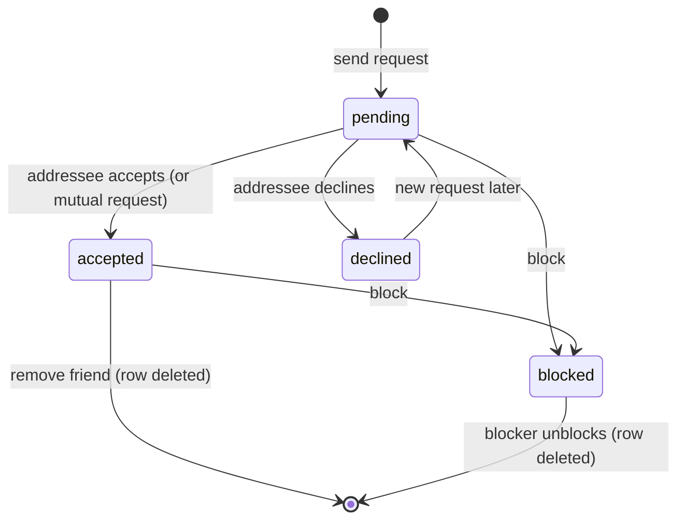

### Buddy tag

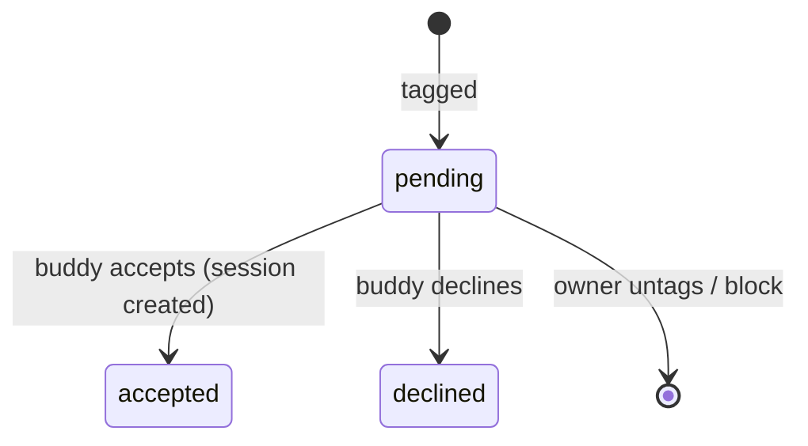

### Photo upload (local only)

```mermaid
stateDiagram-v2
  [*] --> pending: photo added
  pending --> uploading: online
  uploading --> uploaded: success
  uploading --> failed: error
  failed --> uploading: retry (backoff)
  uploaded --> [*]
```
